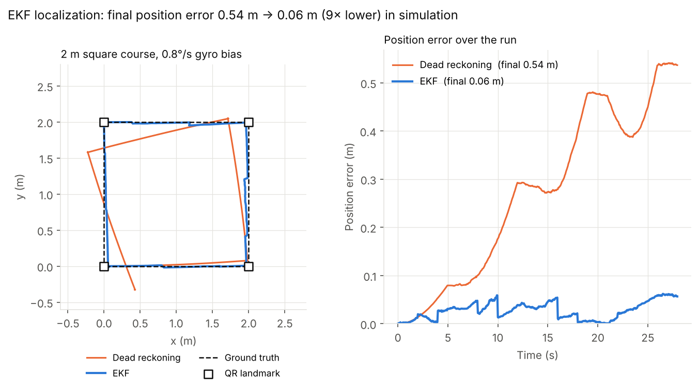

# AVTECH AGV: Forklift Robot

[](https://github.com/eerdemgundogdu/avtech-agv-main/actions/workflows/checks.yml)

Software for a line-following forklift AGV built by ÇÜ AVTECH for the *Sanayide Robotik Uygulamalar 2026* competition. The vehicle uses a hoverboard BLDC drivetrain, a Teensy 4.1 for real-time control and a Jetson Orin Nano as its high-level computer.

The current build (motion-capability video stage) is driven manually from a web GUI. The autonomy modules (camera line detection, QR task reading, sensor fusion, mapping, mission control) are in the repo and can be run standalone, but they are not wired into the running system yet.

```
 Browser GUI  ──Socket.IO──►  Jetson Orin Nano  ──USB serial, JSON @115200──►  Teensy 4.1
 (joystick/WASD)  ◄──telemetry──  Flask server   ◄──────telemetry 10 Hz───────  real-time control
                                                                                 │  │  │
                                                    Hoverboard FOC (UART 0xABCD)─┘  │  └─ DM556 stepper (forklift)
                                                    ICM-20948 IMU (SPI, 100 Hz)─────┘
```

## Teensy firmware (`teensy_firmware/`)

- **Non-blocking, time-sliced main loop:** IMU at 100 Hz, motor commands at 20 Hz, telemetry at 10 Hz. No `delay()` calls on the control path.
- **Hoverboard driver:** speaks the EFeru FOC firmware's USART protocol (speed + steer frames, `0xABCD` start, XOR checksum) and parses feedback frames. Framing, the checksum and speed ramping live in `hover_protocol.cpp`, which has no Arduino dependency and is unit-tested on the host. Frames are decoded byte by byte with explicit little-endian reads (no struct casts over an unaligned buffer), and after a bad checksum the parser resyncs on the next `0xCD 0xAB` inside the rejected bytes instead of dropping them.
- **IMU:** ICM-20948 over SPI with gyro bias calibration and a complementary filter for attitude/yaw.
- **Heading hold:** while driving straight, a PI controller with gyro-rate damping locks the yaw at 50 Hz. It re-targets when the error diverges.
- **Forklift:** DM556 stepper pulsed from an `IntervalTimer` ISR with position tracking, soft limits, homing and a hold-to-move keepalive.
- **Navigation FSM:** IDLE, MANUAL, LINE_FOLLOW, TURN, PICKUP/DROP, OBSTACLE_STOP and FAULT, plus a line-following PID (QTR-8A or a camera offset sent by the Jetson).
- **Safety:** a manual-command timeout with ramp-down, a Jetson link watchdog driven by heartbeats, motor outputs zeroed when inactive, and an E-stop path.
- **Command parser:** a hand-written, allocation-free JSON line parser with bounded buffers (`cmd_parser.cpp`, host-tested). A line that overflows the buffer is dropped whole, so a truncated command never runs.
- `comm_test/` holds single-subsystem bring-up sketches (IMU, QTR, stepper, ultrasonic, UART, safety) and a PC-side test tool.

All pins, gains and timings are in `config.h`.

## Jetson software (`jetson_software/`)

- `avtech_brain.py`: a Flask + Socket.IO server. It resends GUI drive input to the Teensy at a fixed 20 Hz so Wi-Fi jitter doesn't reach the motors, applies a deadman timeout and offers three speed modes.
- `teensy_link.py`: serial link with PJRC VID auto-detection, an exclusive port lock, auto-reconnect and a 5 Hz heartbeat.
- Autonomy modules, each runnable on its own:
  - `camera_node.py`: HSV color-line detection with a perspective (bird's-eye) transform and ArUco markers.
  - `qr_reader.py`: reads pick/drop task QR codes.
  - `ekf_localization.py`: Extended Kalman Filter over `[x, y, θ, gyro_bias]`. Wheel odometry and gyro drive the prediction step. The wheel-derived yaw rate makes the gyro bias observable, and known QR landmarks give range/bearing updates, with a Mahalanobis gate that rejects outliers.
  - `sensor_fusion.py`: wraps the EKF (default) or the older complementary filter (`use_ekf=False`) and adds line/obstacle state.
  - `mapping_node.py`: 2D occupancy grid built from odometry and ultrasonic sensors.
  - `mission_control.py`: task sequencing.
- `ekf_test.py`: square-course simulation with a biased gyro. Final position error is ~0.06 m with the EKF versus ~0.54 m with dead reckoning, and the gyro bias estimate converges (see Results).
- Tools: `calibrate_camera.py` (checkerboard calibration) and `jetson_hsv_tuner.py` (live threshold tuning).

## Carrier board (`hardware/`)

A 2-layer KiCad carrier board for the Teensy 4.1 (**Rev A, design stage: not fabricated or tested yet**). It replaces the hand wiring and fixes its electrical risks: 5 V HC-SR04 echo levels into 3.3 V-only pins, QTR-8A outputs above the ADC range, 3.3 V drive into the DM556 optocouplers, the 15 V wire in the hoverboard UART cable, and a software-only E-stop. The board adds a 24 V input with fuse, reverse-polarity and TVS protection, an LMR16006 24 V → 5 V buck, and a hardware E-stop that drops the motor-power contactor regardless of software.

The schematic and PCB are generated from one netlist (`hardware/gen/design.py`), checked for schematic/PCB parity and run through KiCad DRC. Fabrication outputs (Gerber, drill, BOM, pick-and-place) are in `hardware/output/`. Design decisions and calculations: [`hardware/DESIGN.md`](hardware/DESIGN.md); harness: [`hardware/WIRING.md`](hardware/WIRING.md).

The firmware supports the board behind `CARRIER_BOARD_REV` (`pio run -e teensy41_carrier`); the default build is unchanged.

## Results



A 0.8°/s gyro bias makes dead reckoning drift 0.54 m over a 2 m square course. The EKF estimates the bias from the wheel-derived yaw rate and pulls the pose back at each QR landmark, ending at 0.06 m. This is a simulation (`jetson_software/ekf_test.py`); regenerate the figure with `python3 jetson_software/plot_ekf.py`.

## Testing

Everything below runs in CI on every push, without hardware:

| Check | What it covers |
|-------|----------------|
| `firmware_tests/` (CMake, `-Wall -Wextra -Wconversion -Werror`, ASan + UBSan) | JSON command reader (spaced/compact input, a key's text appearing as a value, overlong lines dropped whole), hoverboard frames against golden bytes, signed feedback decoding, resync after noise, speed ramp limits |
| `pio run` | Teensy 4.1 firmware compiles |
| `jetson_software/ekf_test.py` | EKF accuracy, gyro bias convergence, outlier gating |
| `jetson_software/jetson_mapping_test.py` | Occupancy-grid mapping self-test |

```bash
cmake -S firmware_tests -B build/test && cmake --build build/test && ctest --test-dir build/test
cd jetson_software && python3 ekf_test.py
```

## Running

Teensy: `pio run -t upload` from the repo root, or open `teensy_firmware/teensy_firmware.ino` in the Arduino IDE with Teensyduino and flash it to a Teensy 4.1.

Jetson:

```bash
cd jetson_software
./install_jetson.sh        # installs dependencies and the systemd service
python3 avtech_brain.py    # GUI at http://<jetson-ip>:5000
```

| Key | Action |
|-----|--------|
| W A S D / arrows | drive |
| 1 / 2 / 3 | slow / medium / fast |
| Space / Esc | stop |
| E / Q | forklift up / down (hold) |
| T / G | forklift to top / bottom |
| H | toggle heading hold |

Code comments and log strings are in Turkish.
