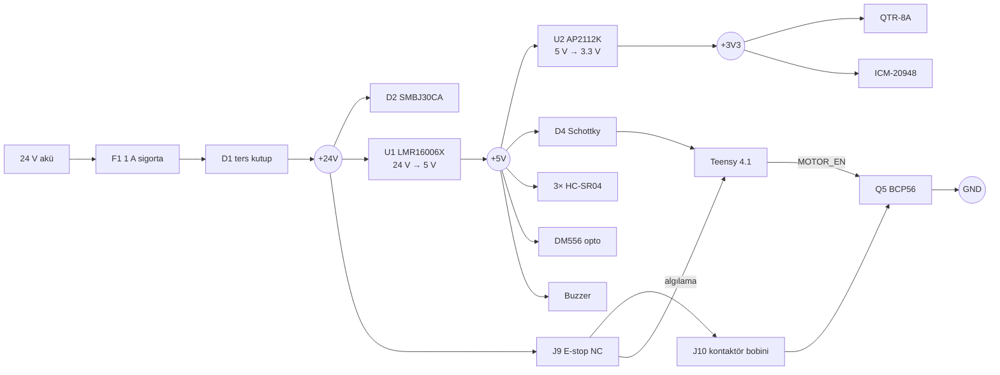

# Tasarım notları — AVTECH AGV taşıyıcı kart Rev A

> **Durum: Rev A, tasarım aşamasında. Kart henüz üretilmedi ve hiçbir parçası donanımda test edilmedi.** Aşağıdaki değerler datasheet'lerden ve hesaptan gelir; ölçülmüş değer değildir. Bu notlar, üretimden önce yapılacak tasarım incelemesinin girdisidir.

## 1. Kart neden var?

Araç bugün Teensy 4.1'e doğrudan kablolanıyor. Mevcut bağlantıları (`teensy_firmware/config.h`) gözden geçirince beş elektriksel sorun çıktı. Kartın her bloğu bunlardan birini çözüyor:

| Sorun | Risk | Karttaki çözüm |
|-------|------|----------------|
| HC-SR04 ECHO çıkışı 5 V, Teensy 4.1 pinleri 5 V toleranslı değil | Otonom mod açılınca pin 25/27/29 hasar görebilir (bugün `MANUAL_ONLY_MODE=1` olduğu için tetiklenmiyor) | 2.2 k / 3.3 k bölücü → 3.0 V |
| QTR-8A analog çıkışları besleme gerilimine kadar çıkar | 5 V ile beslenirse ADC'nin 3.3 V sınırı aşılır | QTR-8A kartın 3.3 V LDO'sundan beslenir |
| DM556 optokuplör girişleri 5 V sinyal ister | 3.3 V ile sınırda çalışır, gürültüde adım kaçırabilir | Ortak anot 5 V + AO3400A alçak taraf anahtarlar |
| Birçok hoverboard UART kablosunda TX/RX'in yanında 15 V hattı var | Yanlış takılan bir kablo Teensy'yi yakar | 3 pinli kilitli konnektör (15 V pini yok), 1 kΩ seri + BAT54S kıskaç |
| E-stop sadece yazılımın okuduğu bir pin (`ESTOP_ENABLED 0`) | Yazılım kilitlenirse motorlar durmaz | Buton, kontaktör bobinini donanımda keser |

## 2. Gereksinimler

| Gereksinim | Değer | Kaynak |
|------------|-------|--------|
| Akü | 24 V nominal (7S Li-ion dolu 29.4 V; kurşun-asit şarjda 28.8 V) | Takım kararı |
| 5 V yük | ~340 mA tahmini (aşağıdaki bütçe) | Hesap |
| 3.3 V yük (sensörler) | ~110 mA tahmini | Hesap |
| Kontaktör bobini | 24 V DC, ≤ 0.4 A | Seçilecek kontaktöre göre |
| Mevcut firmware ile uyum | Pin atamaları korunur; yeni olan sadece pin 38 (`MOTOR_EN`) | `config.h` |

### 5 V güç bütçesi (tahmini)

| Yük | Akım | Not |
|-----|------|-----|
| Teensy 4.1 (600 MHz) | ~100 mA | PJRC verisi |
| 3× HC-SR04 | 3 × 15 mA = 45 mA | Modül verisi |
| AP2112 üzerinden 3.3 V hattı | ~110 mA | QTR-8A + IMU |
| DM556 optokuplör girişleri | 3 × ~16 mA = 48 mA | Hepsi aynı anda iletimde (en kötü durum) |
| Buzzer | ~30 mA | 12 mm aktif buzzer |
| LED'ler | ~5 mA | |
| **Toplam** | **~340 mA** | LMR16006 sınırı 600 mA → %57 |

Jetson Orin Nano bu karttan **beslenmez**. 24 V, Jetson'un 9–20 V giriş aralığının üstünde olduğundan aracın mevcut ayrı DC-DC dönüştürücüsü kullanılmaya devam eder.

## 3. Blok şema



## 4. Güç girişi ve koruma

- **F1 — 1 A, 63 V SMD sigorta (1206).** Yalnızca lojik ve bobin akımını taşır (~0.35 A + ≤ 0.4 A). Motor akımı karttan geçmez.
- **D1 — SS16 Schottky, seri ters kutup koruması.** 60 V / 1 A. Akü ters bağlanırsa devre akım çekmez. Bedeli ~0.4 V düşüm ve ~0.3 W kayıp; bu akımda kabul edilebilir. Daha yüksek akımlı bir revizyonda P-MOSFET ideal diyot tercih edilmeli.
- **D2 — SMBJ30CA TVS.** Çalışma gerilimi (Vrwm) 30 V, normalde görülebilecek en yüksek gerilimin (dolu 7S Li-ion 29.4 V, kurşun-asit şarj 28.8 V) üstünde. Motor frenleme sıçramalarını ve kablo endüktansından gelen tepeleri kıskaçlar. En kötü kıskaç gerilimi ~48 V; bu yüzden U1 (60 V), C2/C3 (100 V), C1 (63 V) ve Q5 (80 V) bunun üstünde seçildi.
- **C1 — 47 µF 63 V elektrolitik.** Akü kablosunun endüktansıyla seramik kondansatörlerin oluşturduğu rezonansı (sıcak takmada gerilim çınlaması) sönümler.

## 5. 24 V → 5 V buck (U1, LMR16006X)

Seçim gerekçesi: 4–60 V giriş, 0.6 A, dahili kompanzasyon, SOT-23-6. Dış parça sayısı az olduğu için yerleşim hatası riski düşük.

**X (700 kHz) ve Y (2.1 MHz) karşılaştırması.** Datasheet minimum açık kalma süresini 80 ns veriyor. En yüksek girişte görev oranı D = 5 / 29.4 = 0.17:

| Versiyon | Ton = D / fsw | 80 ns sınırına göre |
|----------|--------------|---------------------|
| Y, 2.1 MHz | 81 ns | Sınırda; frekans katlama veya darbe atlama başlar |
| X, 700 kHz | 243 ns | 3× pay |

Bu yüzden **X versiyonu** seçildi. Şematik sembolü Y versiyonudur; pinout aynıdır, BOM'da `LMR16006XDDCR` yazar.

**Çıkış gerilimi** (datasheet: VFB = 0.765 V, min 0.747, maks 0.782):

VOUT = 0.765 × (1 + R2 / R3) = 0.765 × (1 + 54.9 k / 10 k) = **4.97 V** (tolerans aralığı 4.85 – 5.08 V)

R2 = 54.9 k ve R3 = 10 k, datasheet tablosundaki 5 V değerleriyle aynıdır.

**Bobin (L1 = 22 µH).** Datasheet'teki 5 V / 700 kHz tasarım örneği en az 20.4 µH hesaplayıp 22 µH seçer. Dalgalanma akımı en kötü (en yüksek) girişte:

ΔI = (VIN − VOUT) × D / (L × fsw) = (29.4 − 5) × 0.17 / (22 µH × 700 kHz) = **0.27 A**

Tepe akım = 0.6 + 0.27 / 2 = 0.74 A. Bobinin doyma akımı **en az 1 A** olmalı; BOM'daki Bourns SRN6045TA-220M bu sınıftadır (siparişten önce datasheet'ten teyit edin).

**Serbest geçiş diyodu (D3, SS16).** LMR16006 senkron değil, harici Schottky ister. Datasheet kuralı: ters gerilim, en yüksek girişin %25 üstünde → 1.25 × 30 V = 37.5 V. SS16 60 V / 1 A, bu kuralı karşılar.

**Kondansatörler.**
- Giriş: 2 × 2.2 µF, 100 V X7R 1210. Seramik kondansatörler DC gerilim altında kapasitans kaybeder; 100 V'luk parça 24 V'ta kapasitansının çoğunu korur.
- Çıkış: 2 × 22 µF, 10 V X7R 1206. Datasheet örneği 10 µF; 5 V DC bias kaybından sonra da 10 µF'ın üstünde kalmak için iki adet.
- Bootstrap: C4 = 100 nF (CB–SW), datasheet önerisi.
- SHDN: Dahili pull-up var; datasheet önerisine uyarak R1 = 100 k ile +24V'a bağlandı.

**Yerleşim.** Giriş kondansatörleri VIN pininin yanında, bootstrap kondansatörü CB ile SW arasında, catch diyodu SW'nin yanında. Anahtarlama akım döngüsü (Cin → yüksek taraf FET → SW → diyot → GND → Cin) mümkün olduğunca küçük tutuldu. SW düğümü kısa ve 0.8 mm genişliğinde.

## 6. 3.3 V LDO (U2, AP2112K-3.3) ve Teensy beslemesi

- AP2112K: 600 mA, düşük düşüm. Kayıp ≈ (5 − 3.3) × 0.11 A = 0.19 W. SOT-23-5'in ısıl direnci yaklaşık 250 °C/W olduğundan ~47 °C sıcaklık artışı beklenir. Kabul edilebilir, ama ilk testte termal kamerayla kontrol edilmeli.
- **D4 (B5819W) — Teensy VIN.** Teensy 4.1'de VIN ve VUSB pedleri varsayılan olarak birbirine bağlıdır. Kart VIN'i beslerken Jetson USB'den de 5 V geldiğinde, iki kaynak doğrudan birbirine bağlanmış olur. D4, kart 5 V'unun USB hattına ve USB'nin kart 5 V'una geri beslemesini engeller. PJRC'nin önerdiği alternatif, Teensy'nin altındaki VIN-VUSB köprüsünü kesmektir; o yapılırsa D4'e gerek kalmaz.
- Teensy'nin kendi 3.3 V çıkışı kullanılmaz (en fazla 250 mA ve Teensy'nin kendisi ~100 mA çekiyor); sensörler U2'den beslenir.

## 7. Sinyal arayüzleri

### Hoverboard UART
- Konnektörde sadece GND / TX / RX var; kablodaki 15 V teli kartta karşılıksız kalır.
- Her iki hatta 1 kΩ seri direnç + BAT54S kıskaç (GND ve +3V3'e). Hatta 15 V değerse akım: (15 − 3.3 − 0.3) / 1 kΩ ≈ 11 mA. Bu akım +3V3 hattına akar; U2'nin yükü (~110 mA) bu akımdan büyük olduğu için hat yükselmez.
- **Bilinen sınırlama:** QTR-8A ve IMU sökülüyse 3.3 V hattının yükü 11 mA'in altına düşebilir ve hat yükselebilir. Rev B'de +3V3'e bir zener/TVS eklenmeli.
- 1 kΩ, 115200 baud için sorun değil: hoverboard girişinin ~10 pF kapasitansıyla RC ≈ 10 ns, bit süresi 8.7 µs.

### HC-SR04 ×3
- ECHO: 2.2 kΩ / 3.3 kΩ bölücü → 5 × 3.3 / 5.5 = **3.0 V**. Teensy VIH (0.7 × 3.3 V) = 2.31 V; pay yeterli.
- TRIG: Teensy 3.3 V çıkışı HC-SR04'ün TTL girişini doğrudan sürer (100 Ω seri).

### QTR-8A
- 3.3 V besleme ile çıkışlar ADC tam ölçeğini aşamaz. IR LED akımı 5 V'a göre düşer; `LINE_THRESHOLD` (bugün 500) yeniden kalibre edilmelidir.

### IMU (ICM-20948, SPI0 7 MHz)
- SCK ve MOSI hatlarında 33 Ω seri direnç: kablo üzerinden yansımaları ve kenar hızını sönümler.

### DM556 step sürücü
- Ortak anot: PUL+/DIR+/ENA+ = 5 V; PUL−/DIR−/ENA− kartta AO3400A ile GND'ye çekilir.
- AO3400A: VGS(th) en fazla 1.45 V. Teensy'nin 3.3 V çıkışıyla tam iletime girer. Gate'te 100 Ω seri direnç ve 100 kΩ pull-down var; Teensy resetteyken girişler kapalı kalır.
- Mantık mevcut kablolamayla aynı (pin HIGH = opto iletimde), firmware değişmez. Adım darbesi 5 µs, DM556'nın minimum 2.5 µs darbe şartını karşılar.

### Buzzer
- 5 V aktif buzzer, AO3400A alçak taraf + 1N4148W serbest geçiş diyodu.

## 8. Donanımsal acil stop

```
+24V ── J9 ── [E-stop NC] ── J9 ── ESTOP_RET ── J10 ── [kontaktör bobini] ── J10 ── COIL_N ── Q5 (BCP56) ── GND
                                       │                                                          │
                                       └── 47k/10k + 3.3V zener ── 1k ── Teensy pin 36       Teensy pin 38 (MOTOR_EN)
```

- **Yazılımdan bağımsız durdurma:** Buton basılınca bobinin 24 V beslemesi fiziksel olarak kesilir; Teensy ne yaparsa yapsın kontaktör düşer.
- **Ek yazılım katmanı:** Teensy, `MOTOR_EN` ile bobini ayrıca bırakabilir (arıza durumu, Jetson bağlantı kaybı). Bu katman motor gücünü sadece **kesebilir**, butonun kestiği gücü geri **veremez**.
- **Reset/boot güvenliği:** Teensy resetteyken veya firmware çalışmıyorken pin 38 yüksek empedanstadır. 10 kΩ pull-down (R28) Q5'i kapalı tutar, kontaktör düşük kalır.
- **Q5 (BCP56-16):** 80 V, 1 A NPN. Baz akımı (3.3 − 0.9) / 470 Ω = 5.1 mA. 0.4 A bobin için zorunlu kazanç 0.4 / 0.0051 = 78; BCP56-16'nın minimum hFE'si 100. Transistör doymada kalır, kayıp ≈ 0.3 V × 0.4 A = 0.12 W.
- **D10 (SS16) serbest geçiş diyodu:** Bobin bırakılırken oluşan gerilim tepesini kıskaçlar. **Bilinen sınırlama:** Sadece diyot kullanmak bobin akımının yavaş sönmesine, dolayısıyla kontaktörün birkaç ms ile birkaç on ms geç düşmesine yol açar. Rev B'de diyoda seri bir zener (ör. 24 V) eklenerek düşme süresi kısaltılmalı.
- **Algılama:** ESTOP_RET → 47 k / 10 k bölücü → 3.3 V zener kıskaç → 1 k → pin 36.

| Durum | ESTOP_RET | Pin 36 | Firmware |
|-------|-----------|--------|----------|
| Normal, akü 18 V (çok boş) | 18 V | 3.16 V → HIGH | normal |
| Normal, akü 29.4 V (dolu) | 29.4 V | 5.2 V → zener 3.3 V'a kıskaçlar | normal |
| Buton basılı | 0 V | 0 V → LOW | `NAV_FAULT_ESTOP` |

  Mevcut firmware kuralıyla aynıdır (basılı = LOW). Fark: harici bölücü olduğu için pin `INPUT_PULLUP` değil `INPUT` olmalıdır. Bu, `CARRIER_BOARD_REV=1` ile otomatik ayarlanır.

## 9. Firmware entegrasyonu

`teensy_firmware/config.h` içinde `CARRIER_BOARD_REV` bayrağı:

- `0` (varsayılan): Bugünkü kablolama, davranış değişmez.
- `1`: E-stop etkin (`INPUT`), pin 38 `MOTOR_EN` çıkışı. Kontaktör; arıza yokken, Jetson bağlantısı varken ve E-stop basılı değilken açıktır. E-stop arızası kilitlenir; `reset` komutuna kadar güç kapalı kalır.

Derleme: `pio run -e teensy41_carrier`. CI iki varyantı da derler.

## 10. PCB

| Parametre | Değer |
|-----------|-------|
| Boyut | 110 × 85 mm, köşeler R3 |
| Katman | 2, FR-4 1.6 mm, 1 oz bakır |
| Kurallar | İz/boşluk 0.25 / 0.2 mm, via 0.6 / 0.3 mm, kenar boşluğu 0.5 mm (JLCPCB ve PCBWay standart kapasitesi içinde) |
| GND | İki katmanda da bakır döküm, termal bağlantılı |
| Montaj | 4 × M3 delik |

İz genişlikleri (1 oz, IPC-2221 yaklaşımıyla, ~10 °C artış için gereğinden geniş):

| Net | Genişlik | Akım |
|-----|----------|------|
| VBAT_IN, VBAT_F, +24V, BUCK_SW | 0.8 mm | ≤ 0.8 A |
| +5V, ESTOP_RET, COIL_N | 0.6 mm | ≤ 0.5 A |
| GND (döküm dışındaki izler), TEENSY_VIN | 0.5 mm | |
| +3V3 | 0.4 mm | ≤ 0.15 A |
| Sinyaller | 0.25 mm | |

**Daraltılan iz bölümleri (neck-down).** Kalın güç izleri, ince aralıklı pinlere (SOT-23, SOT-23-5, SOT-23-6) girerken pinin en fazla 1 mm çevresinde 0.3 mm'ye iner; aksi halde komşu pine 0.2 mm boşluk kalmaz. İz, bu bölgenin dışında tam genişliğindedir. Örnek: buck girişi (+24V) U1'in 0.95 mm aralıklı VIN pinine bu şekilde girer. Bu kısa daralmanın direnci ihmal edilebilir (0.3 mm × 1 mm, 1 oz bakır ≈ 2 mΩ). Dalın tamamının ince çizilmek zorunda kaldığı durumlar [output/routing_report.txt](output/routing_report.txt) içinde listelenir.

**Nasıl üretildi?** Netlist tek bir kaynaktan (`gen/design.py`) gelir; şematik, yerleşim, yol çizimi ve döküm betiklerle üretilir (bkz. [README.md](README.md)). Yollar iki katmanlı bir ızgara A* yönlendiricisiyle (`gen/router.py`) çizildi ve KiCad DRC'siyle doğrulandı. Elle ince ayar yapılmadı; insan gözüyle bir yerleşim incelemesinden geçmeli (bölüm 12).

## 11. Doğrulama

| Kontrol | Sonuç |
|---------|-------|
| Şematik ↔ tasarım bağlantı paritesi (KiCad netlist'i `design.py` ile karşılaştırıldı) | 63 / 63 net birebir aynı |
| KiCad DRC (KiCad 7, yerel) | 0 ihlal, 0 bagli olmayan ped; ayrinti: [output/drc_report.txt](output/drc_report.txt). CI ayrica KiCad 9 ile ERC + DRC (sematik paritesi dahil) calistirir |
| Datasheet hesapları | Bu dokümanda (bölüm 4–8) |

**Yapılmayanlar:** Kart üretilmedi ve ölçülmedi; devre simülasyonu (SPICE) ve termal analiz yapılmadı. Footprint'ler KiCad standart kütüphanesinden alındı; Teensy 4.1 footprint'i ve pin sırası PJRC pin kartından elle girildi ve **siparişten önce gerçek bir Teensy'yle karşılaştırılmalı**.

## 12. Siparişten önce inceleme listesi

- [ ] Teensy 4.1 pin sırasını PJRC pin kartıyla karşılaştır; footprint'i 1:1 çıktı alıp gerçek Teensy'yi üstüne koyarak kontrol et.
- [ ] L1'in doyma akımı ≥ 1 A mi? (seçilen parçanın datasheet'i)
- [ ] Kontaktör seçimi: bobin 24 V DC ≤ 0.4 A, ana kontak akımı motorlara uygun.
- [ ] Hoverboard kablosunun pin sırası (GND/TX/RX) gerçek kabloyla eşleşiyor mu?
- [ ] ICM-20948 kartının pin adları J3 sırasıyla eşleşiyor mu?
- [ ] Buck yerleşimini KiCad'de aç ve gözle incele: SW düğümü kısa mı, giriş kondansatörü VIN'e yakın mı?
- [ ] Gerber'leri üreticinin görüntüleyicisinde aç (katman, delik ve maske kontrolü).

## 13. Devreye alma (ilk enerji)

1. Teensy takılmadan, akım sınırlı laboratuvar güç kaynağıyla başla: 24 V, 100 mA sınır.
2. TP2'de 5 V (4.85 – 5.08), TP3'te 3.3 V ölç. Boştaki akım ~10 mA civarında olmalı. Yeşil LED (D5) yanmalı.
3. Kaynağı 12 V'a düşür, 5 V'un hâlâ regülasyonda olduğunu doğrula; sonra 29.4 V'a çık.
4. J1'i ters bağla: akım akmamalı (D1).
5. E-stop döngüsü: J9'a butonu, J10'a 24 V röle/kontaktör bağla. Pin 38'e 3.3 V uygula → kırmızı LED (D11) yanmalı ve kontaktör çekmeli. Butona bas → kontaktör düşmeli, pin 36 LOW olmalı.
6. Teensy'yi tak, `pio run -e teensy41_carrier -t upload` ile yükle. USB takılıyken ve çıkarılmışken 5 V'u kontrol et.
7. Sensörleri tek tek bağla, `teensy_firmware/comm_test/` içindeki test sketch'leriyle doğrula.
8. QTR-8A'yı 3.3 V'ta yeniden kalibre et (`LINE_THRESHOLD`).

## 14. Rev B için fikirler

- +3V3 hattına aşırı gerilim kıskacı (UART kıskaçlarından gelen akıma karşı).
- Kontaktör bobini serbest geçişine seri zener (daha hızlı düşme).
- Seri Schottky yerine P-MOSFET ters kutup koruması.
- Akü gerilimi ölçümü için Teensy ADC'sine bölücü.
- Hoverboard UART için izole arayüz (motor tarafı gürültüsüne karşı).
