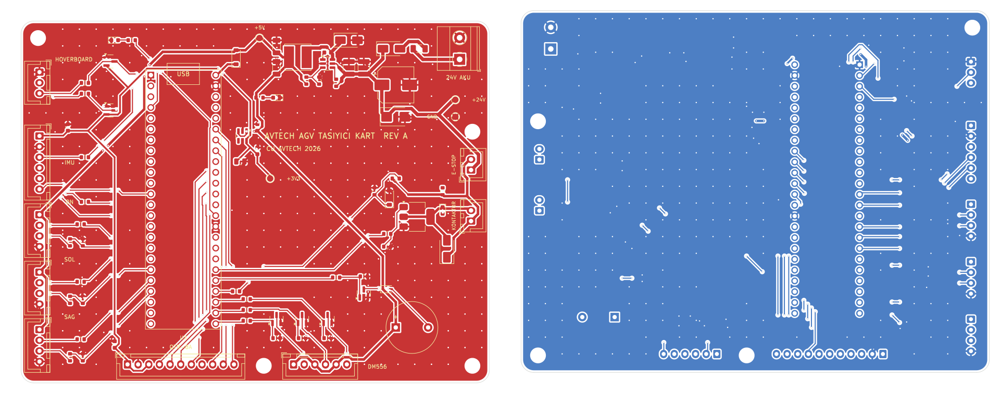

# AVTECH AGV carrier board — Rev A

> **Status: design stage. Rev A has not been fabricated or tested on hardware.** Values come from datasheets and calculations, not measurements. See the pre-order review list in [DESIGN.md](DESIGN.md#12-siparişten-önce-inceleme-listesi).

A 2-layer carrier board for the forklift AGV. The Teensy 4.1 plugs into it, and every sensor and actuator cable has a keyed connector. It fixes five electrical problems in the current hand wiring:

- 5 V HC-SR04 echo outputs driving the Teensy 4.1's 3.3 V-only pins
- QTR-8A analog outputs that can exceed the 3.3 V ADC range
- 3.3 V signals driving the DM556's 5 V optocoupler inputs
- an exposed 15 V wire in the hoverboard UART cable
- an E-stop that only software reads



| Block | Parts |
|-------|-------|
| Power input | 1 A fuse, SS16 reverse-polarity diode, SMBJ30CA TVS, 47 µF bulk |
| 24 V → 5 V | LMR16006X buck (60 V, 0.6 A, 700 kHz), 22 µH |
| 5 V → 3.3 V | AP2112K LDO for sensors; Teensy VIN through a Schottky so USB and board 5 V don't back-feed each other |
| Hardware E-stop | NC button in series with the motor-power contactor coil. Pressing it drops the contactor regardless of software. The Teensy can also release the contactor (`MOTOR_EN`) and reads the loop state. |
| Hoverboard UART | 3-pin keyed connector without the 15 V wire, 1 kΩ series and BAT54S clamps |
| HC-SR04 ×3 | Echo dividers (5 V → 3.0 V) |
| QTR-8A | Powered from 3.3 V so its outputs stay inside the ADC range |
| DM556 | Common-anode 5 V drive through AO3400A low-side switches |
| IMU | ICM-20948 over SPI0, 33 Ω series damping |

## Files

| Path | What it is |
|------|------------|
| [`DESIGN.md`](DESIGN.md) | Requirements, every design decision and its calculation, PCB rules, verification, bring-up procedure (Turkish) |
| [`WIRING.md`](WIRING.md) | Pin-by-pin harness table for every connector (Turkish) |
| `avtech-agv-carrier/` | KiCad project: schematic, PCB, project library (Teensy 4.1 symbol and footprint) |
| `output/` | Gerber + drill zip, pick-and-place CSV, BOM, schematic PDF, DRC report, routing report |
| `gen/` | The scripts that generate everything above |

## How it is built

The netlist has a single source, `gen/design.py`: every part, its value, manufacturer part number and pin-to-net map. Everything else is generated from it, so the schematic and the PCB cannot drift apart:

1. `make_lib.py` writes the Teensy 4.1 symbol and footprint (not in KiCad's stock libraries).
2. `make_sch.py` writes the schematic. `check_parity.py` exports KiCad's own netlist from it and checks that all 63 nets match `design.py` exactly.
3. `make_pcb.py` loads the footprints, assigns nets and places parts.
4. `router.py` routes both layers with a grid A* router (45°/90° moves, via and turn costs, per-net widths, neck-down into fine-pitch pads).
5. `finish_pcb.py` adds GND pours on both layers and runs KiCad's DRC.
6. `export.py` writes the fabrication outputs.

```bash
cd hardware/gen
python3 build.py     # KiCad 7 (pcbnew + kicad-cli), kiutils, numpy, scipy
```

Open `avtech-agv-carrier/avtech-agv-carrier.kicad_pro` in KiCad 7 or newer to review or edit by hand.

## Firmware

The firmware supports the board behind a build flag, so the current vehicle is unaffected:

```bash
pio run                         # current wiring (CARRIER_BOARD_REV=0)
pio run -e teensy41_carrier     # Rev A board: E-stop sense on pin 36, MOTOR_EN on pin 38
```
